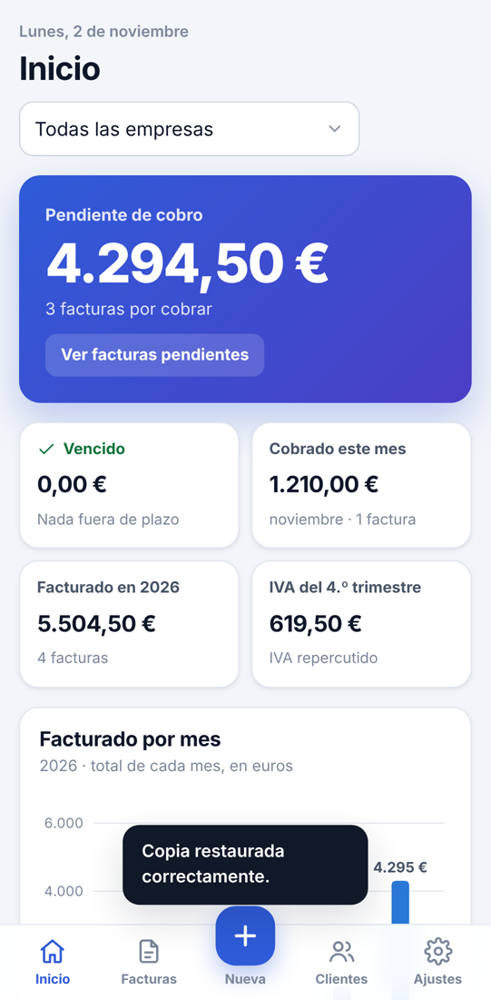
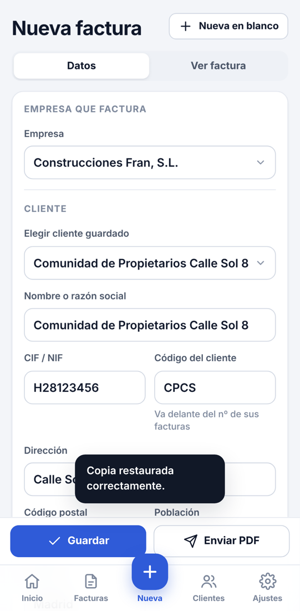
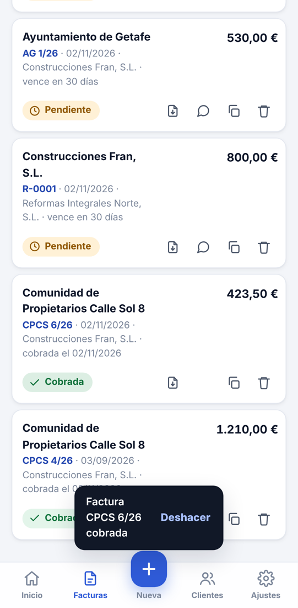
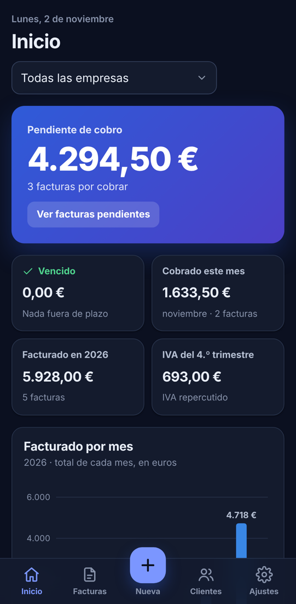
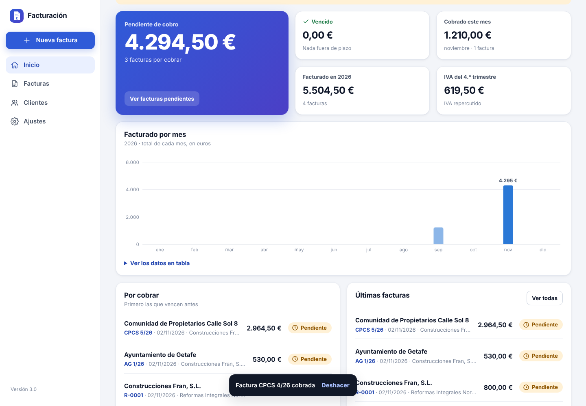
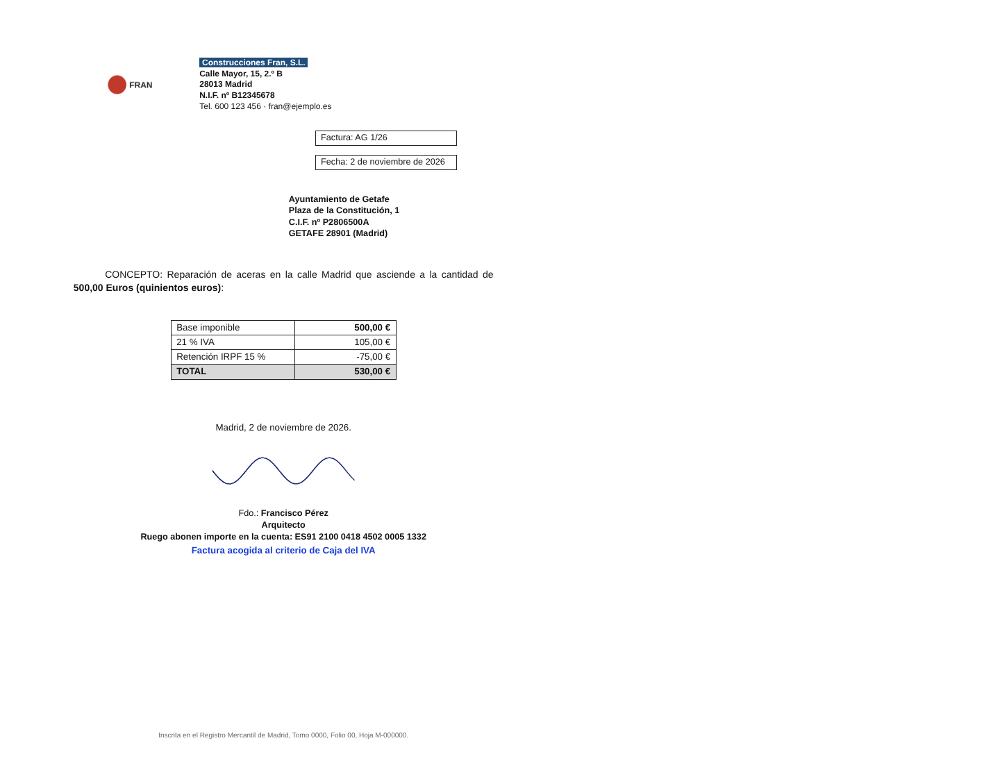

# Facturación: app para hacer facturas desde el móvil

App para hacer las facturas de **varias empresas**, cada una con **su plantilla** (logo, datos y firma) y con
**numeración propia de cada cliente**. Lleva la cuenta de qué está **cobrado**, qué está **pendiente** y qué
está **vencido**.

- **Se instala en el móvil** (Android o iPhone) desde un enlace, con su icono.
- **Funciona sin internet** una vez instalada.
- **Envía la factura en PDF** por WhatsApp o correo, y **recuerda el cobro** con un toque.
- **Los datos se guardan en el propio dispositivo**. No se envían a ningún servidor.

**Enlace de la app:** https://ai-phi-design.github.io/FACTURATION-PROGRAM-/

| Inicio | Nueva factura | Facturas | Modo oscuro |
|---|---|---|---|
|  |  |  |  |

## Instalarla en el móvil

1. Abre el enlace en el móvil:
   - **Android:** con **Chrome**.
   - **iPhone:** con **Safari**.
2. Instálala:
   - **Android:** pulsa **“Instalar”** en el aviso de Inicio, o menú **⋮** → **“Instalar aplicación”**.
   - **iPhone:** botón **Compartir** → **“Añadir a pantalla de inicio”**.
3. A partir de ahí se abre desde el icono **Facturación**, también sin conexión.

## Cómo se usa

- **Ajustes → Mis empresas → Añadir empresa.** Se rellenan una vez:
  - los datos de la empresa;
  - el **logo**;
  - la **firma** (se dibuja con el dedo o se sube una foto);
  - el **cargo** que va debajo de la firma (por ejemplo, “Arquitecto”);
  - el **IBAN**;
  - la **nota legal** (por ejemplo, “Factura acogida al criterio de Caja del IVA”);
  - el **diseño** de la factura:
    - **Clásica:** como las facturas que se hacían en Word;
    - **Moderna:** con color.
- **Botón +** (Nueva factura):
  1. Elige el **cliente**. El número sale solo con el formato **`A 15/26`**: código del cliente, número y año.
     Cada año vuelve a empezar en el 1.
  2. Escribe el **concepto** y la **base imponible**.
     - El **importe en letra** se añade solo al concepto: “…que asciende a la cantidad de 2.450,00 Euros (dos
       mil cuatrocientos cincuenta euros)”.
     - El **IVA** se puede quitar (indicando el motivo) y se puede añadir **retención de IRPF**.
     - El **vencimiento** se calcula con el plazo de pago de la empresa.
  3. **Guardar** → **Enviar PDF** (WhatsApp, correo…).
- **Inicio:**
  - cuánto hay **pendiente de cobro** y cuánto está **vencido**;
  - lo **cobrado este mes**, lo **facturado en el año** y el **IVA del trimestre**;
  - un **gráfico** de lo facturado cada mes;
  - las facturas por cobrar.
- **Facturas:**
  - filtros **Todas / Pendientes / Vencidas / Cobradas**, por año, trimestre y búsqueda;
  - un toque en la etiqueta marca la factura como **cobrada**, con opción de **Deshacer**;
  - desde cada factura: **PDF**, **recordar el cobro por WhatsApp o email**, **duplicar** o **borrar**;
  - **Enviar al gestor**: un CSV para Excel.
- **Ajustes:**
  - **copia de seguridad**: descargar o restaurar;
  - **instalar la app**;
  - **modo claro u oscuro**.

| Ordenador: Inicio | Factura impresa / PDF |
|---|---|
|  |  |

Ejemplo de factura en PDF, con datos inventados: [`docs/factura-ejemplo.pdf`](docs/factura-ejemplo.pdf).

## ⚠️ Copias de seguridad

Los datos viven en el dispositivo. **Si se borra la app o se cambia de móvil, solo se recuperan con una copia.**
Cuando lleva más de 7 días sin copia, Inicio lo avisa.

- **Hacer una copia:** Ajustes → **Descargar copia**. Guárdala fuera del móvil.
- **Pasar los datos a otro móvil:** instala la app y usa **Restaurar…**.

## Privacidad: el repositorio es público

El código está en un repositorio **público**. **No se suben datos reales**: ni NIF, ni IBAN, ni firmas, ni clientes.
Para dejar la app preparada a alguien, se le pasa **en privado** un archivo `.json` de configuración y lo carga
en **Ajustes → Restaurar…**.

## Aviso legal (Veri\*factu)

El Reglamento de sistemas de facturación (RD 1007/2023, “Veri\*factu”) obligará a que los programas de
facturación encadenen y firmen cada factura, lleven un código QR y, según la modalidad, envíen los registros a
Hacienda. Según la última información disponible, se **aplazó a 2027** (1 de enero para sociedades y 1 de julio
para el resto). Esta app **todavía no** lo incluye. Confirmad las fechas con el gestor.

La numeración por cliente funciona como una **serie distinta para cada cliente**. Conviene que el gestor dé el
visto bueno.

## Para desarrolladores

- Es una app web sin compilación. Archivos:
  - `index.html`: todo el programa;
  - `manifest.json` y `sw.js`: lo que la hace instalable y le permite funcionar sin conexión;
  - `iconos/`;
  - `vendor/`: jsPDF y html2canvas, para el PDF.
- **Publicación:** GitHub Pages desde la rama de trabajo, carpeta raíz. Al cambiar archivos, sube `VERSION` en `sw.js`.
- Prueba de punta a punta, en ordenador y en móvil:

  ```bash
  node pruebas/prueba-completa.cjs
  ```

  - Usa Chromium con Playwright y el reloj fijado en el 2 de noviembre de 2026.
  - Comprueba que la app se puede instalar y que funciona sin conexión.
  - Comprueba la numeración, los vencimientos, el IRPF, el importe en letra, la opción de deshacer, el
    recordatorio, el gráfico, el PDF, la impresión, el CSV, las copias de seguridad, el botón «atrás», el modo
    oscuro y el diseño móvil.
- Requisitos: [`docs/requisitos-audios.md`](docs/requisitos-audios.md).
- Cómo se hizo, paso a paso: [`docs/COMO-SE-HIZO.md`](docs/COMO-SE-HIZO.md).
