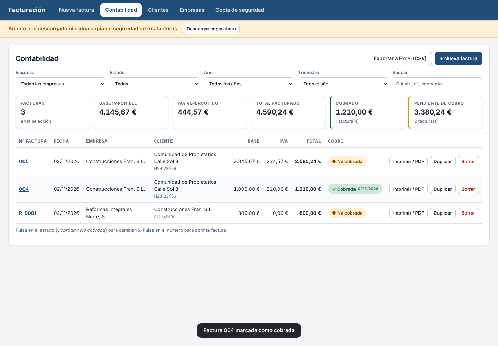

# Programa de facturación

Programa sencillo para hacer facturas de **varias empresas**, cada una con **su plantilla (logo, datos, firma)**
y **su propia numeración**, y llevar en la pestaña **Contabilidad** qué facturas están **cobradas** y cuáles no.

- **Es un solo archivo:** `index.html`. Se abre con doble clic en Chrome, Edge o Firefox.
- **Funciona sin internet** y no necesita instalar nada.
- **Los datos se guardan en el propio ordenador**, dentro del navegador. No se envían a ningún sitio.


## Cómo se usa

1. **Empresas → Añadir empresa.** Rellena nombre, CIF, dirección y población. Sube el **logo**, y **dibuja o
   sube la firma**. Pon el **IBAN** y el color de la plantilla.
   En **“Número de la próxima factura”** pon el número que toca. Si ya ibas por la 3ª, pon `4`.
2. **Nueva factura.** Elige la empresa. El número y la fecha salen solos. Rellena el cliente (nombre, CIF,
   dirección, población), el **concepto** y la **base imponible**. Marca o desmarca **“Aplicar IVA”** y cambia
   el % si hace falta. El **total** se calcula solo.
3. **Guardar e imprimir / PDF.** Se abre la ventana de impresión: elige la impresora o **“Guardar como PDF”**.
4. **Contabilidad.** Aquí están todas las facturas. Pulsa **“No cobrada”** para marcarla como **cobrada** (y al
   revés). Puedes filtrar por empresa, estado, año y trimestre, y ver los totales facturado, cobrado, pendiente
   e IVA repercutido. **“Exportar a Excel (CSV)”** saca el listado para el gestor.

| Contabilidad | Factura impresa |
|---|---|
|  |  |

Ejemplo de factura en PDF: [`docs/factura-ejemplo.pdf`](docs/factura-ejemplo.pdf).

## Qué hace

- **Varias empresas**, cada una con su logo, sus datos, su color, su firma, su IBAN y su texto al pie.
- **Numeración por empresa**, no global. Se puede poner una serie (`A-`, `2026/`…) y el número de cifras (`004`).
  - No deja repetir un número.
  - Avisa si queda un hueco o si las fechas no van en orden con los números.
- **Clientes guardados**: se guardan solos al hacer la factura y luego se eligen de una lista.
- **IVA**: % editable (21, 10, 4…), o **sin IVA** indicando el motivo (exenta, inversión del sujeto pasivo…),
  que sale impreso.
- **Importes** calculados en céntimos, sin errores de redondeo. Admite `1.250,50`, `1250,5` o `1250.50`.
- **Cobro**: cobrada / no cobrada con fecha de cobro.
- **Duplicar** una factura para hacer otra parecida.
- **Copia de seguridad**: descargar y restaurar todos los datos en un archivo `.json`. El programa avisa si
  llevas más de 7 días sin hacer copia.

## ⚠️ Importante: copias de seguridad

Los datos viven en el navegador del ordenador donde se usa. **Si se borran los datos del navegador o se cambia
de ordenador, solo se recuperan con una copia.** Descarga una copia cada semana desde **Copia de seguridad** y
guárdala en un pendrive, en el correo o en la nube. Para pasar el programa a otro ordenador: copia `index.html`
y restaura allí la última copia.

Usa siempre el mismo navegador y el mismo archivo `index.html` en la misma carpeta. Cada navegador guarda sus
propios datos.

## Aviso legal (Veri\*factu)

El Reglamento de sistemas de facturación (RD 1007/2023, “Veri\*factu”) obligará a que los programas de
facturación encadenen y firmen cada factura, lleven un código QR y, según la modalidad, envíen los registros a
Hacienda. Según la última información disponible, su entrada en vigor se **aplazó a 2027** (1 de enero para
sociedades y 1 de julio para el resto). Este programa **todavía no** incluye esos requisitos. Confirmad las
fechas con el gestor antes de que entre en vigor.

## Para desarrolladores

- Todo el programa está en `index.html` (HTML + CSS + JavaScript, sin librerías ni compilación).
- Prueba automática de punta a punta (Chromium con Playwright):

  ```bash
  node pruebas/prueba-completa.cjs
  ```

  Deja capturas, un PDF y un CSV de ejemplo en `pruebas/salida/`.
- Requisitos originales (transcripción de los audios de Fran): [`docs/requisitos-audios.md`](docs/requisitos-audios.md).
- Cómo se hizo, paso a paso, para repetirlo igual: [`docs/COMO-SE-HIZO.md`](docs/COMO-SE-HIZO.md).
