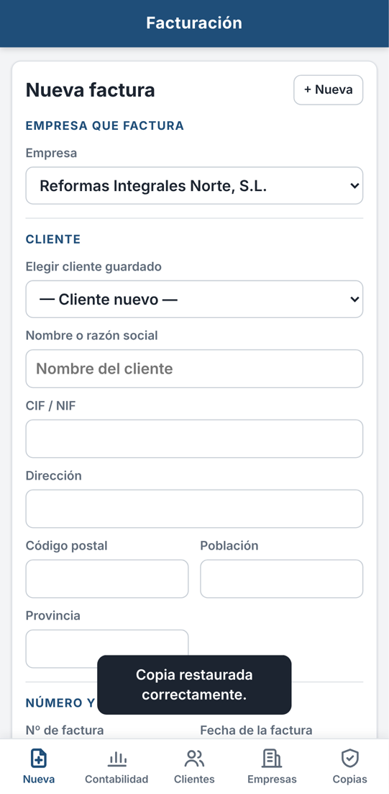
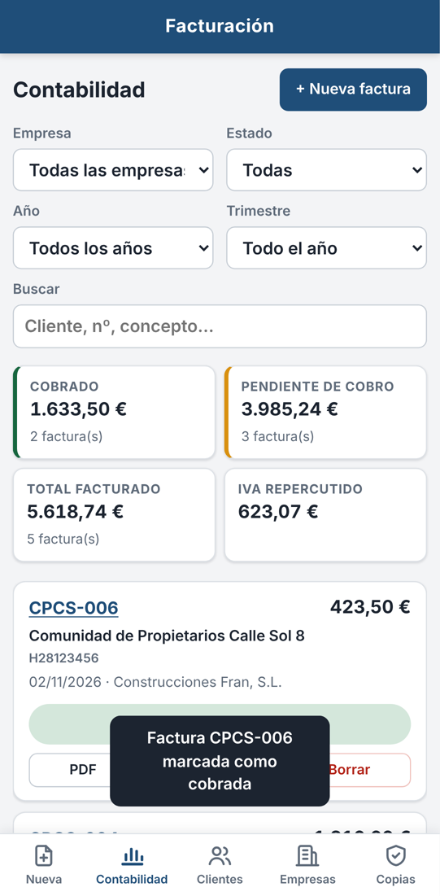
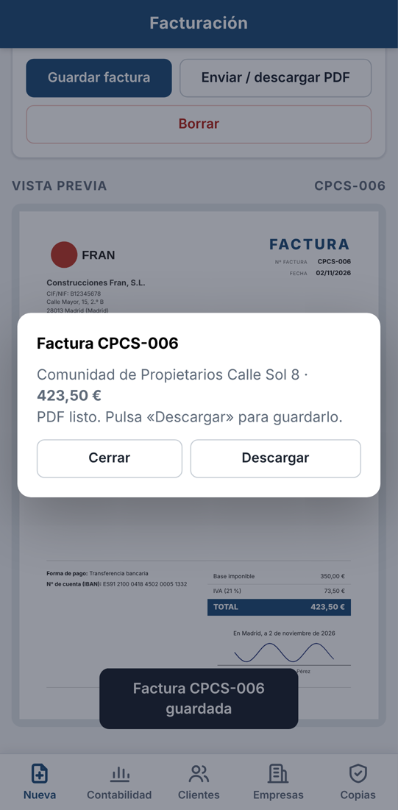
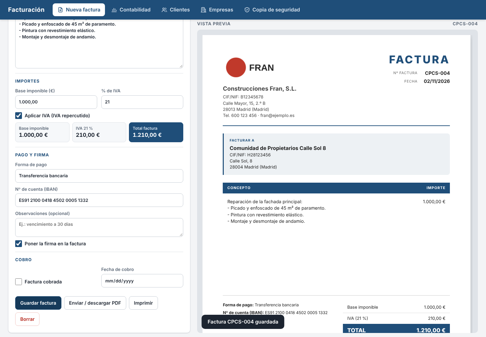

# Facturación: app para hacer facturas desde el móvil

App para hacer facturas de **varias empresas**, cada una con **su plantilla** (logo, datos y firma), con
**numeración propia de cada cliente**, y llevar en **Contabilidad** qué facturas están **cobradas** y cuáles no.

- **Se instala en el móvil** (Android o iPhone) desde un enlace, como una app más, con su icono.
- **Funciona sin internet** una vez instalada.
- **Envía la factura en PDF** por WhatsApp, correo… desde el propio móvil.
- **Los datos se guardan en el propio móvil** (u ordenador). No se envían a ningún servidor.

**Enlace de la app:** https://ai-phi-design.github.io/FACTURATION-PROGRAM-/

| Nueva factura | Contabilidad | Enviar PDF |
|---|---|---|
|  |  |  |

## Instalarla en el móvil

1. Abre el enlace en el móvil:
   - **Android:** con **Chrome**.
   - **iPhone:** con **Safari**.
2. Instálala:
   - **Android:** pulsa **“Instalar”** en el aviso azul, o menú **⋮** → **“Instalar aplicación”**.
   - **iPhone:** botón **Compartir** (cuadrado con flecha) → **“Añadir a pantalla de inicio”**.
3. A partir de ahí se abre desde el icono **Facturación**, también sin conexión.

En el ordenador también se puede usar (y se puede instalar en Chrome o Edge).

## Cómo se usa

1. **Empresas → Añadir empresa.** Rellena nombre, CIF, dirección y población. Sube el **logo** y **dibuja la
   firma con el dedo** (o sube una foto). Pon el **IBAN** y el color de la plantilla.
2. **Nueva factura.** Elige la empresa y el **cliente**:
   - Cada cliente tiene un **código** (por ejemplo, `CPCS` para “Comunidad de Propietarios Calle Sol”) y
     **su propia numeración**: `CPCS-001`, `CPCS-002`…
   - Si a un cliente ya le habías hecho facturas, en su primera factura escribe el número que toca (por
     ejemplo, el 4). Después sigue solo: 5, 6…
   - Luego rellena el **concepto** y la **base imponible**, y marca o desmarca **“Aplicar IVA”**. El **total**
     se calcula solo.
3. **Guardar factura** y luego **“Enviar / descargar PDF”** → **Enviar** (WhatsApp, correo…) o **Descargar**.
4. **Contabilidad.** Aquí están todas las facturas.
   - Toca **“No cobrada”** para marcarla como **cobrada**, y al revés.
   - Puedes filtrar por empresa, estado, año y trimestre.
   - Arriba ves los totales: cobrado, pendiente, facturado e IVA repercutido.

| Ordenador: nueva factura | Factura impresa / PDF |
|---|---|
|  |  |

Ejemplo de factura en PDF: [`docs/factura-ejemplo.pdf`](docs/factura-ejemplo.pdf).

## Qué hace

- **Varias empresas**, cada una con su logo, sus datos, su color, su firma, su IBAN y su texto al pie.
- **Numeración**:
  - **Por cliente** (por defecto): cada cliente lleva su código y su contador (`CPCS-004`). Si se prefiere,
    una empresa puede usar **una sola numeración** para todos sus clientes (`A-0004`).
  - No deja repetir números ni códigos de cliente.
  - Avisa si queda un hueco en la numeración o si las fechas no van en orden con los números.
- **Clientes guardados**: se guardan solos al hacer la factura. Si escribes el CIF de uno que ya existe, se
  elige solo.
- **IVA** con el % editable (21, 10, 4…), o **sin IVA** indicando el motivo, que sale impreso.
- **Importes** calculados en céntimos, sin errores de redondeo. Admite `1.250,50`, `1250,5` o `1250.50`.
- **PDF para enviar** desde el móvil, **imprimir** desde el ordenador y **CSV para Excel** (para el gestor).
- **Duplicar** una factura para hacer otra parecida.
- **Copia de seguridad**: descargar y restaurar todos los datos en un archivo `.json`. Avisa si llevas más
  de 7 días sin hacer copia.

## ⚠️ Importante: copias de seguridad

Los datos viven en el dispositivo donde se usa la app. **Si se borra la app o se cambia de móvil, solo se
recuperan con una copia.** Desde **Copias → Descargar copia de seguridad**, guarda una copia cada semana en el
correo, Google Drive o iCloud. Para pasar los datos a otro móvil, instala allí la app y usa **Restaurar una copia**.

## Aviso legal (Veri\*factu)

El Reglamento de sistemas de facturación (RD 1007/2023, “Veri\*factu”) obligará a que los programas de
facturación encadenen y firmen cada factura, lleven un código QR y, según la modalidad, envíen los registros a
Hacienda. Según la última información disponible, se **aplazó a 2027** (1 de enero para sociedades y 1 de julio
para el resto). Esta app **todavía no** lo incluye. Confirmad las fechas con el gestor.

La numeración por cliente usa una **serie distinta por cliente** (el código delante del número). Conviene que el
gestor dé el visto bueno.

## Para desarrolladores

- Es una app web sin compilación:
  - `index.html`: todo el programa;
  - `manifest.json` + `sw.js`: lo que la hace instalable y le permite funcionar sin internet;
  - `iconos/`;
  - `vendor/`: jsPDF y html2canvas, para el PDF. Se cargan solo al crear un PDF.
- **Publicación:** GitHub Pages desde la rama de trabajo (carpeta raíz). El archivo `.nojekyll` evita que
  Jekyll procese el sitio. Al cambiar archivos, sube `VERSION` en `sw.js`.
- Prueba automática de punta a punta, en ordenador y en móvil (Chromium con Playwright):

  ```bash
  node pruebas/prueba-completa.cjs
  ```

  La prueba levanta un servidor local y comprueba:
  - que Chrome la considera instalable;
  - que funciona sin internet;
  - la numeración por cliente, la contabilidad, el PDF, el CSV, la impresión y las copias;
  - el diseño móvil.

  Deja capturas y PDFs en `pruebas/salida/`.
- Requisitos (audios de Fran + cambios pedidos después): [`docs/requisitos-audios.md`](docs/requisitos-audios.md).
- Cómo se hizo, paso a paso, para repetirlo igual: [`docs/COMO-SE-HIZO.md`](docs/COMO-SE-HIZO.md).
