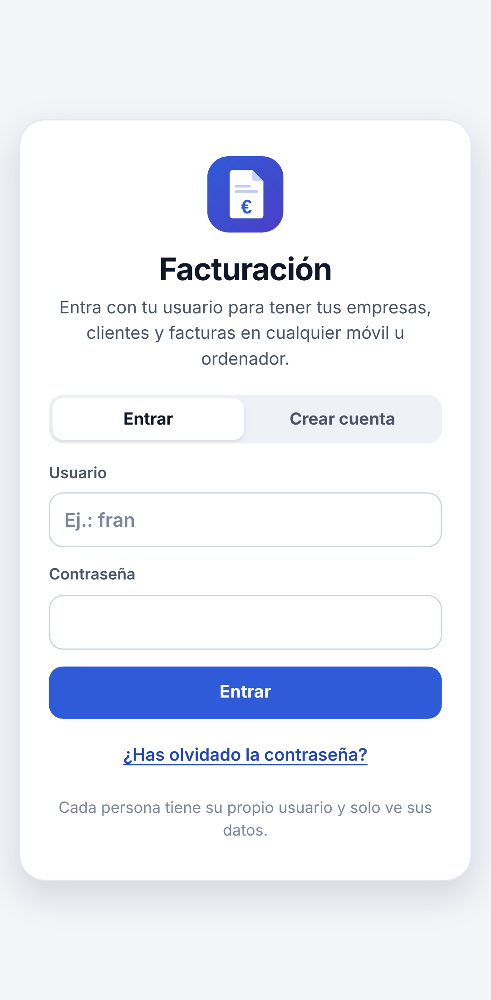

# Cuentas: correo y contraseña por persona

Con las cuentas activadas, cada persona (Fran, tu madre…) entra con **su correo y su contraseña** y tiene
**todas sus empresas, clientes y facturas** en cualquier móvil u ordenador. Si cambia algo en el móvil, aparece solo
en el ordenador. Sin internet se puede seguir trabajando: los cambios se suben al volver la conexión.

Los datos se guardan en **Firebase** (de Google): el acceso con contraseña es *Firebase Authentication* y los datos
van en *Cloud Firestore*. Para el uso de esta app, el plan gratuito (**Spark**) sobra y no pide tarjeta.

**Estado: activadas** desde el 04/11/2026, con el proyecto de Firebase `facturacion-536fc` (plan gratuito Spark).
Para comprobar el proyecto real: `herramientas/comprobar-firebase.sh` (crea una cuenta de prueba, guarda, lee,
comprueba las reglas y lo borra todo). Con `window.CONFIG_NUBE = null` (en `index.html`, `<script id="config-nube">`), la app vuelve a
funcionar **sin cuentas** (los datos en cada dispositivo).



## ¿Dónde se guardan los datos y quién los ve?

| Dónde | Qué hay | Quién lo ve |
|---|---|---|
| **Cloud Firestore** (Google), en el proyecto de Firebase `facturacion-536fc`, que es de la cuenta de Google que lo creó | Todo: empresas (con logo y firma), clientes, facturas y ajustes de cada persona | Cada persona, **solo lo suyo** (lo imponen las reglas de `firestore.rules`). El **dueño del proyecto** puede verlo todo desde la consola de Firebase (Firestore Database → Datos). Google lo guarda cifrado como proveedor. |
| **Cada móvil u ordenador** donde alguien ha entrado | Una copia de sus datos, para trabajar sin internet | Quien use ese dispositivo. Se borra al **cerrar la sesión**. |
| **GitHub** (repositorio público) | Solo el **código** de la app, nunca datos | Cualquiera |
| **Anthropic** (solo con el lector con IA) | El PDF o la foto que se le pasa para leer los datos del cliente | Se envía solo para leerlo; la app no lo guarda allí |

- **Las contraseñas** se guardan cifradas (*hash*) en Firebase Authentication: nadie puede verlas, ni el dueño del
  proyecto.
- **La ubicación** (por ejemplo, `europe-southwest1`, Madrid) se elige al crear la base de datos y no se puede
  cambiar. Se ve en Firestore Database o en Configuración del proyecto → General.
- **Plan gratuito (Spark):** 1 GB de datos y miles de lecturas y escrituras al día, mucho más de lo que usa la app.
  Si un día se pasara, dejaría de guardar en la nube hasta el día siguiente, pero **nunca cobra** (no hay tarjeta).
- **Tamaño:** cada empresa, cliente o factura es un documento de Firestore (máximo 1 MB). Por eso el logo y la firma
  se reducen a 300 KB como mucho. Si algo no cabe, la app avisa y no lo sube.

**Recomendaciones:**

1. Activar la **verificación en dos pasos** en la cuenta de Google dueña del proyecto: quien entre en esa cuenta
   puede ver y borrar todos los datos.
2. **Descargar una copia** cada mes (Ajustes → Descargar copia; Inicio lo recuerda a los 30 días). En el plan
   gratuito no hay copias automáticas, y lo que se borra en un dispositivo se borra en todos.
3. Cuando todos tengan cuenta, **cerrar el registro** de cuentas nuevas (paso 8 de abajo).

## Activarlas (una sola vez, unos 10 minutos)

1. Entra en **https://console.firebase.google.com** con tu cuenta de Google → **Crear un proyecto**.
   - Nombre: por ejemplo `facturacion`. Google Analytics: **no hace falta**.
2. **Authentication** → **Comenzar** → pestaña **Método de inicio de sesión** → **Correo electrónico/contraseña** →
   **Habilitar** → Guardar. (El «Vínculo de correo electrónico» no hace falta).
3. **Firestore Database** → **Crear base de datos**:
   - Ubicación: una de Europa, por ejemplo `europe-southwest1` (Madrid). **No se puede cambiar después.**
   - Modo: **producción**.
   - «Copias de seguridad programadas (opcional)» pide el plan Blaze: **no se marcan** y no se pulsa
     «Actualizar proyecto». Se pulsa **Crear**.
4. En Firestore, pestaña **Reglas**: borra lo que hay, pega el contenido de [`firestore.rules`](../firestore.rules) y
   pulsa **Publicar**. Estas reglas hacen que **cada usuario solo pueda leer y escribir sus propios datos**.
5. **⚙ Configuración del proyecto** → **Tus apps** → icono **`</>`** (Web) → nombre `Facturación` → **Registrar app**
   (sin Firebase Hosting). Sale un bloque `firebaseConfig` con `apiKey`, `authDomain`, `projectId`, `appId`…
6. **Pásale ese bloque a Claude**, o pégalo tú en `index.html`, dentro de `<script id="config-nube">`:

   ```js
   window.CONFIG_NUBE = {
     firebase: {
       apiKey: 'AIza…',
       authDomain: 'facturacion-xxxx.firebaseapp.com',
       projectId: 'facturacion-xxxx',
       appId: '1:…:web:…',
     },
     permitirRegistro: true,
   };
   ```

   Estos datos **no son secretos** (van dentro de cualquier app web de Firebase) y se pueden subir al repositorio
   público. Lo que protege la información son las reglas del paso 4 y las contraseñas.
7. Al publicarlo, la app pide correo y contraseña. Cada persona pulsa **Crear cuenta** la primera vez.
   - Si en ese móvil ya había facturas de antes, la app pregunta si se pasan a la cuenta.
8. **Recomendado:** cuando ya estén creadas las cuentas de todos, cierra la puerta a cuentas nuevas:
   - en `index.html` (`CONFIG_NUBE`), `permitirRegistro: false` (quita el botón «Crear cuenta»);
   - y en Firebase: **Authentication → Configuración → Acciones del usuario** → desmarca **Habilitar creación
     (registro)**. Esto es lo que lo impide de verdad. Las cuentas nuevas se crean entonces en
     **Authentication → Usuarios → Agregar usuario**, con el correo `nombre@usuarios.facturacion.app`.

## Hacerlo con un asistente (Gemini u otro)

Si prefieres que lo haga (o te guíe) un asistente con IA, pégale este texto. Si el asistente puede manejar el
navegador, lo hace él; si no, te lleva paso a paso. Al final te da el bloque `firebaseConfig` para el paso 6.

```text
Necesito que me configures un proyecto de Firebase para una app web de facturación que ya está hecha
(https://ai-phi-design.github.io/FACTURATION-PROGRAM-/). Si puedes usar mi navegador, hazlo tú en
https://console.firebase.google.com con mi cuenta de Google. Si no puedes, guíame paso a paso: dime solo un
paso cada vez y espera a que te diga que está hecho.

1. Crea un proyecto nuevo llamado "facturacion". Sin Google Analytics. Debe quedarse en el plan gratuito
   (Spark): no actives la facturación ni el plan Blaze, y no metas ninguna tarjeta.
2. Authentication → Comenzar → Método de inicio de sesión → activa SOLO "Correo electrónico/contraseña"
   (no actives "Vínculo de correo electrónico"). Guardar.
3. Firestore Database → Crear base de datos. Si pregunta la edición, "Standard". ID de la base de datos:
   (default). Ubicación: europe-southwest1 (Madrid). Modo: producción.
4. Firestore Database → pestaña Reglas → borra todo, pega exactamente este texto y pulsa Publicar:

rules_version = '2';
service cloud.firestore {
  match /databases/{database}/documents {
    match /usuarios/{uid} {
      allow read, write: if request.auth != null && request.auth.uid == uid;
      match /{coleccion}/{docId} {
        allow read, write: if request.auth != null && request.auth.uid == uid
          && coleccion in ['empresas', 'clientes', 'facturas'];
      }
    }
  }
}

5. Configuración del proyecto (rueda dentada) → General → Tus apps → icono Web (</>) → apodo "Facturación".
   NO marques Firebase Hosting. Registrar app.
6. Dame el bloque firebaseConfig completo, tal cual (apiKey, authDomain, projectId, storageBucket,
   messagingSenderId, appId).

Importante: no actives ningún otro servicio, no cambies nada más y no me hagas instalar nada en el ordenador
(no hace falta npm ni la herramienta de línea de comandos de Firebase). Si algún paso pide pagar o una
tarjeta, para y avísame. Al terminar, confírmame uno por uno los pasos hechos.
```

## El correo

- Se entra con **un correo de verdad** y una contraseña (mínimo 6 caracteres). Si se olvida la contraseña, el botón
  **«¿Has olvidado la contraseña?»** manda a ese correo un enlace para poner otra.
- También se admite **un nombre** sin espacios (`fran`, `mama`…). Por dentro se convierte en
  `fran@usuarios.facturacion.app`, un correo que no existe, así que con un nombre no se puede recuperar la
  contraseña por correo.

## Si alguien olvida la contraseña

- **Si entra con su correo:** pantalla de acceso → escribe el correo → **¿Has olvidado la contraseña?**
- **Si entra con un nombre:** quien gestiona el proyecto de Firebase le pone una nueva:
  1. Abre **https://shell.cloud.google.com** con la cuenta de Google dueña del proyecto.
  2. Sube [`herramientas/cambiar-clave.py`](../herramientas/cambiar-clave.py) (menú ⋮ → Subir) y ejecuta:

     ```bash
     python3 cambiar-clave.py facturacion-xxxx fran contraseña-nueva
     ```

- Una vez dentro, cada uno puede cambiar su contraseña en **Ajustes → Mi cuenta → Cambiar contraseña**.

## Cómo funciona (para desarrolladores)

- **Datos:** `usuarios/{uid}` (los ajustes) y `usuarios/{uid}/empresas|clientes|facturas/{id}`: un documento por
  registro, con el mismo formato que la copia de seguridad.
- **Sin internet:** Firestore guarda una copia en el dispositivo (`persistentLocalCache`) y la app otra en
  `localStorage` (`facturacion.datos.u.<uid>`), para que se vea al instante. Los cambios hechos sin conexión se
  suben solos.
- **Guardar:** `guardarDatos()` compara cada registro con lo último que hay en la nube y sube solo lo que ha cambiado
  (y borra lo que ya no está), en lotes de hasta 400 operaciones.
- **Tiempo real:** `onSnapshot` en cada colección. Los formularios a medio rellenar no se tocan.
- **Cerrar sesión:** espera a que se suba lo pendiente, borra la copia del dispositivo y vuelve a la pantalla de
  acceso.
- **SDK:** `vendor/firebase.mjs` (Firebase 13, Apache 2.0), hecho con `herramientas/empaquetar-firebase.sh`. Se usa
  `initializeAuth` y no `getAuth`, para no cargar scripts de Google que no hacen falta.
- **Pruebas:** la sección 17 de `pruebas/prueba-completa.cjs` usa los **emuladores** de Firebase
  (`herramientas/emuladores-firebase.sh`, necesita Java 11+). La configuración de prueba se pone en
  `localStorage['facturacion.nube.prueba']`; con el valor `'null'` se desactivan las cuentas en ese navegador (así
  se prueban las partes 1–16 y se hacen las capturas sin cuentas). Al proyecto real no se le hace nada desde las
  pruebas: solo se comprueba que, con `CONFIG_NUBE` tal cual, la app pide correo y contraseña.
- **La configuración va dentro de `index.html`**, no en un archivo aparte: la página se pide siempre primero a
  internet, así que un cambio llega a la primera, también a los móviles con una versión vieja instalada (con un
  `config-nube.js` aparte, el *service worker* viejo seguía dando la copia antigua y no salía «Crear cuenta»). La
  prueba 18 lo comprueba simulando la actualización de una app instalada.
- **Actualizaciones:** al volver a la app (estaba en segundo plano) se busca versión nueva; si llega justo al abrir y
  no hay nada a medio hacer, la app se recarga sola. Al instalarse, la caché se llena con `cache: 'reload'` para no
  coger copias viejas de la caché HTTP de GitHub Pages (10 minutos).
